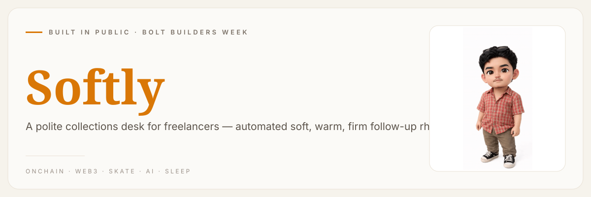
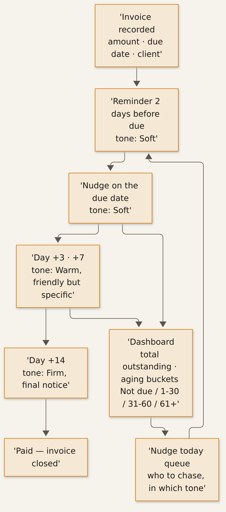

<!-- Softly — a polite collections desk for freelancers -->

**[urelkdubdqwr](https://github.com/urelkdubdqwr)** · [website](https://studiopinggirkasur.xyz/)

**A polite collections desk for freelancers — automated soft, warm, firm follow-up rhythm.**

## What it is

Get paid without the awkward part. Softly schedules the follow-up rhythm for your unpaid invoices automatically — reminder 2 days before due, a nudge on the due date, then day +3, +7, +14, and a firm final notice — and writes the message for you in three tones: *Soft* ("just confirming this came through"), *Warm* (friendly but specific) and *Firm* (clear, final notice). Solo operators lose real cash chasing invoices because asking for money feels awkward; the dashboard tracks total outstanding, aging buckets (Not due / 1–30 / 31–60 / 61+ days) and a **Nudge today** queue so you never have to decide *when* or *how* to ask.

- **LIVE:** https://softly-polite-collec-dufo.bolt.host
- **Built with:** [Bolt](https://bolt.new) — 100% during Bolt Builders Week
- **Demo:** [`softly-demo.mp4`](./softly-demo.mp4)

## How it works

- An invoice goes in with its amount, client and due date — from that moment the rhythm is scheduled for you.
- **2 days before due:** a soft reminder ("just confirming this came through").
- **Due date:** the nudge lands, still soft.
- **Day +3 and +7:** tone shifts to Warm — friendly, but specific about the invoice.
- **Day +14:** Firm — a clear, final notice. Then the invoice gets marked paid and closed.
- The dashboard watches total outstanding and aging buckets (Not due / 1–30 / 31–60 / 61+ days), and the **Nudge today** queue lines up who to chase and in which tone.

## Quickstart

No local build here — the app is live on Bolt's free tier:

1. Open [softly-polite-collec-dufo.bolt.host](https://softly-polite-collec-dufo.bolt.host).
2. Log an invoice (amount, client, due date).
3. Hit the **Nudge today** queue to see the follow-up rhythm and the Soft/Warm/Firm drafts.
4. Watch the desk track outstanding totals and aging buckets on its own.

Known non-blocker: the `Reset demo data` button freezes the currently live build; the fix landed in the Bolt project (Version 2) but the free-tier rebuild stalls. Demo resets are cosmetic — the follow-up engine is unaffected. Clip of the desk in action: [`softly-demo.mp4`](./softly-demo.mp4).

## What's inside

| File | What |
|---|---|
| `SUBMISSION_PACK.md` | Bolt Builders Week submission pack (business description, links, status) |
| `softly-demo.mp4` | Demo video (captioned) |
| `assets/header.svg` | Banner |
| `assets/ecosystem.png` | Follow-up rhythm diagram (source: `assets/diagram.mmd`) |
| `LICENSE` | MIT |

## License

MIT — see [`LICENSE`](./LICENSE).

---

*Worked from the edge of the bed. → [studiopinggirkasur.xyz](https://studiopinggirkasur.xyz/)*
